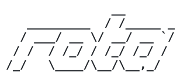
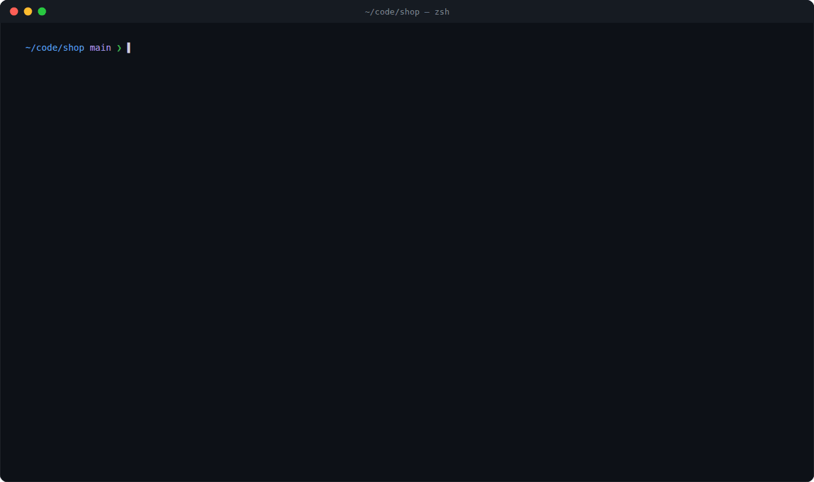

<div align="center">



# rota

**Capture, build and ship work with Claude Code or Codex, one item or many.**

rota turns a to-do list into reviewed, merged work. You capture an item, your agent builds it in small commits, and `/rota-ship` reviews the branch and merges it. Set `work.mergeStrategy` to `pr` to open a pull request instead. What the project learned is kept for the next session.

[](https://github.com/l4ci/rota/releases)
[](LICENSE)
[](https://github.com/l4ci/rota/commits)
[](https://github.com/l4ci/rota/stargazers)
[](https://skills.sh/l4ci/rota)
[](https://claude.com/claude-code)
[](https://developers.openai.com/codex)
[](#-runs-in-herdr-or-tmux)

[Website](https://volkerotto.net/rota/) · [Quick start](#-quick-start) · [How it works](#-how-it-works) · [Rounds](#-parallel-rounds) · [herdr and tmux](#-runs-in-herdr-or-tmux) · [Accounts](#-several-accounts-balanced) · [Skills](#-skills) · [Docs](docs/)

</div>

---

## 🔌 Works with

| | Supported | Set up in |
|---|---|---|
| **Forges** (where code lands) | [GitHub](https://github.com), [GitLab](https://gitlab.com) (self-hosted too), local (no remote, direct merge) | [Issue source and forge](docs/usage/issue-backend.md#issue-source-and-forge) |
| **Issue sources** | `BACKLOG.md` in the repo, [GitHub Issues](https://docs.github.com/en/issues), [GitLab Issues](https://docs.gitlab.com/ee/user/project/issues/), [Jira](https://www.atlassian.com/software/jira), [Linear](https://linear.app), [It's a Plan](https://github.com/croffasia/itsaplan) | [Issue backend](docs/usage/issue-backend.md) · [Tracker connections](docs/usage/configuration.md#tracker-connections) |
| **Agent harnesses** | [Claude Code](https://claude.com/claude-code), [Codex](https://developers.openai.com/codex), [OpenCode](https://opencode.ai) | [Codex workers](docs/usage/codex-workers.md) · [OpenCode workers](docs/usage/opencode-workers.md) |
| **Terminal hosts** (a round needs one) | [herdr](https://herdr.dev), [tmux](https://github.com/tmux/tmux) | [Parallel rounds](docs/usage/parallel-rounds.md) |

---

## 🚀 Quick start

One agent, one item at a time. You need git and [Claude Code](https://claude.com/claude-code) or Codex. No herdr, tmux, `gh` or second account. The steps below are written for Claude Code. In Codex, type `$rota-capture` where it says `/rota-capture`; see [skills in Codex](docs/usage/codex-skills.md).

```bash
brew install l4ci/tap/rota   # or: curl -fsSL https://raw.githubusercontent.com/l4ci/rota/main/install.sh | sh
rota skills install          # adds the /rota-* skills to Claude Code and Codex
cd your-project && rota setup
```

`rota setup` asks the main config questions (backlog, isolation, merge strategy, autonomy, review and QA gates) and creates `.rota/`. Commit it. For scripts and CI, `rota init` does the same without asking and writes the defaults. Then, in Claude Code:

```text
/rota-capture fix the login redirect loop; add a dark mode toggle
/rota-work      # picks the next item, plans it, builds it in small commits
/rota-ship      # reviews the branch, then opens a PR or merges
```

[Install](docs/install.md) lists every way to get the binary (the script checks the sha256 and, if `minisign` is installed, the signature). [Getting started](docs/getting-started.md) walks through setup and the loop.

How each install route updates:

| Route | Update with |
|---|---|
| [Claude Code plugin](#claude-code-plugin) | `claude plugin update rota@rota` |
| `rota skills install` | `rota skills update` |
| `npx skills add l4ci/rota` | run it again |
| Homebrew or install script | `rota update` prints the command |

### Claude Code plugin

Install it from the marketplace in one line (Claude Code 2.1.275 or later):

```text
/plugin install rota --marketplace l4ci/rota
```

On older versions, run `/plugin marketplace add l4ci/rota`, then `/plugin install rota@rota`.

The plugin carries the skills, not the `rota` binary. Run `/rota:rota-install` to get it:

- It installs the binary at the plugin's version. It uses Homebrew when `brew` is on your `PATH`, and otherwise downloads and runs [`install.sh`](https://raw.githubusercontent.com/l4ci/rota/main/install.sh) from this repo.
- It runs `rota doctor` and reports the result.
- It never uses `sudo`, edits your shell profile or runs `rota skills install`.

The plugin downloads nothing on its own. At session start it prints a one-line hint when the binary is missing or has another version.

Then run `rota setup` in your project. [Install](docs/install.md#-plugin-marketplace) has the details.

## 🩹 Problems this fixes

- Agents start building before the task is clear. `/rota-brainstorm` and `/rota-plan` settle it first.
- A session ends and the next one starts blind. `.rota/` and `/rota-pause` carry state across.
- Parallel agents collide or merge red. Each gets a worktree, and the gate tests every PR merged with the base before it lands.
- Lessons get lost. `/rota-learn` and `/rota-decide` keep them where the next session reads them.

## 🔄 How it works

rota has two parts: **skills**, slash commands like `/rota-work` that tell the agent how to do a job well, and the **`rota` CLI**, which the skills call to do the bookkeeping and enforce the rules (who holds which issue, what may merge).

There are two ways to use it. The [quick start](#-quick-start) above is the first; move to the second when several issues are ready at once.

**1. One agent, one item at a time.** You stay in the conversation.

```text
/rota-capture  →  /rota-work  →  /rota-ship
 write it down     build it      review, then PR or merge
```

**2. A round: several agents in parallel.** You stay available for questions.

```text
                        ┌─► worker ben  ─► PR ─┐
issues ─► orchestrator ─┼─► worker dana ─► PR ─┼─► gate ─► main
                        └─► worker nia  ─► PR ─┘
```

- **Orchestrator**: one agent that picks the next issues, hands them out, answers workers' questions, and merges. It asks you only for product decisions.
- **Workers**: agents that each take one issue in their own git worktree and terminal tab, build it, and open a PR. They never merge.
- **Gate**: the only merge path. It checks the PR is current and properly signed off, runs your full test suite on a scratch merge of the PR and the base, and merges only on a pass. A red result sends the PR back to its worker. With `test.fullWhere ci` the suite runs in CI instead.

Both ways share a memory in `.rota/`: what the project has learned (`KNOWLEDGE.md`), the lines it must not cross (`DECISIONS.md`), and handoff notes, so a fresh session picks up where the last one stopped.

## 🧵 Parallel rounds

A round runs several independent issues side by side. [Your first round](docs/first-round.md) sets it up; you'll want `gh` (or `glab`) and [herdr](https://herdr.dev) or tmux.

<p align="center"></p>
<p align="center"><sub>A round in herdr's split view (illustration with a sample project; the palette is rota's real first screen).</sub></p>

## 🪟 Runs in herdr or tmux

A round runs in your terminal, not in a cloud dashboard. Start the orchestrator inside [herdr](https://herdr.dev) or [tmux](https://github.com/tmux/tmux) and rota gives every worker its own tab (tmux: window), so you can watch any agent, or type into one, at any time.

- **herdr** reports each agent's state directly (working, blocked, done), and rota waits on those events instead of polling.
- **tmux** works too: rota reads the panes to tell what each worker is doing.
- **Neither?** The round still runs, with workers as subagents of the orchestrator.

> [!TIP]
> On a wide screen, `rota layout split` folds the workers into the orchestrator's tab as one grid (as in the demo above); `rota layout tabs` gives each its own tab again. In the `rota` palette, one View entry switches between them.

Workers can be Claude Code, Codex or [OpenCode](docs/usage/opencode-workers.md), mixed in one round: a `harness:codex` or `harness:opencode` label, or the first entry of `round.harnesses`, picks per issue or per project.

## 🔀 Several accounts, balanced

Long rounds run into usage limits. List your accounts and rota spreads the work and routes around limits:

- **Load balancing.** With several Claude accounts in `round.accounts`, `rota round assign` puts new work on the account with the most headroom and skips one that is cooling down.
- **Limits.** When a worker hits a limit, `rota limit watch` moves its issue to a free slot on another account, continuing from the pushed branch, or waits for the reset if none is free.
- **The orchestrator** can hand off and restart under another account before it hits its own limit (`orchestrator.switchOnUsage`), and `rota keepalive` restarts it if it stops.
- **Codex.** `round.accounts` entries with `kind: "codex"` spread Codex workers over several logins (rota can't read Codex usage, so these aren't balanced by headroom). Entries with `kind: "opencode"` do the same for OpenCode.

Setup: [parallel rounds](docs/usage/parallel-rounds.md#-setup) and [unattended rounds](docs/usage/unattended-rounds.md).

## 🧰 Skills

In the order you'd usually reach for them:

<!-- generated:skills:readme begin -->
<!-- edit docs/skills/*.md and run python3 scripts/skills-docs.py -->

| When | Skill | What it does |
|---|---|---|
| Something to do | `/rota-capture` | Record bugs, features and tasks in the backlog without starting work |
| Not sure how | `/rota-brainstorm`, `/rota-spike` | Negotiate the design of one Major item before planning it; Try one risky idea on a throwaway branch and keep only the finding |
| Ready to build | `/rota-plan`, `/rota-work` | Write a signed-off implementation plan with verifiable tasks; Build the next item in small commits, one verified task at a time |
| Something broke | `/rota-debug` | Find the root cause of one bug, fix it atomically and prove it |
| Done | `/rota-review`, `/rota-ship` | Review a branch against its spec and conventions before it leaves; Review, then open the PR or merge, linking items by ID |
| Docs drifted | `/rota-docs` | Scaffold, update or reorganize the public docs |
| Many issues at once | `/rota-orchestrate`, `/rota-answer` | Run a parallel round: pick the slate, watch workers, merge their PRs; Answer every decision a round is waiting on, one question at a time |
| Worth remembering | `/rota-learn`, `/rota-decide` | Save the session's durable lessons to KNOWLEDGE.md; Record a hard-boundary decision with explicit forbids and permits |
| Fresh project | `/rota-init` | Suggest config values from the repo and write the ones you confirm |
| rota itself misbehaved | `/rota-bugreport` | File rota's own mistakes upstream, after your explicit yes |
| Out of context | `/rota-pause` | Stop cleanly and leave a handoff note for the next session |
| Bigger picture | `/rota-vision`, `/rota-refactor`, `/rota-qa`, `/rota-release` | Turn an idea into milestones with dependencies and ready/blocked status; Review the architecture and file refactor issues; --map drafts the map; Run product-level QA against the built artifact and score it; Cut a release: checklist, version bump, notes, tag, publish |
<!-- generated:skills:readme end -->

Every skill: [skills](docs/skills/README.md). Settings: [configuration](docs/usage/configuration.md).

## ⚖ How rota compares

See how rota compares to [GSD](docs/compare/gsd.md), [Superpowers](docs/compare/superpowers.md), [OpenSpec](docs/compare/openspec.md), [ralph](docs/compare/ralph.md), [Conductor](docs/compare/conductor.md), [Orca](docs/compare/orca.md), [Vibe Kanban](docs/compare/vibe-kanban.md), [Claude Squad](docs/compare/claude-squad.md), [Gas Town](docs/compare/gastown.md), [Octo](docs/compare/octo.md) and [a bare Claude Code session](docs/usage/rota-vs-plain-session.md).

## 📚 Docs

- [Getting started](docs/getting-started.md): install and your first item, end to end
- [Your first round](docs/first-round.md): orchestrator, workers and the gate, step by step
- [How it works](docs/how-it-works.md): the roles, the map of skills and files, and how skills chain
- [FAQ](docs/faq.md) · [All docs](docs/)

## 🤝 Contributing

Issues and PRs welcome; [SCOPE.md](SCOPE.md) says what rota does and how issues are judged. Run `python3 test/validate-skills.py`, `bash test/doclint.sh` and `bash test/smoke.sh` before a PR; add a smoke assertion when you touch a verb. Running a round on rota itself: [contributing: rounds](docs/contributing/rounds.md).

## License

[MIT](LICENSE)
