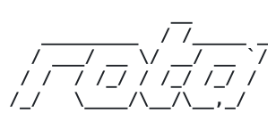

<p align="center">
  
  <br><br>
  
</p>

# Run coding agents in parallel

rota coordinates coding agents across tasks and accounts. Workers build in separate worktrees; the orchestrator reviews their changes and runs your configured checks on the combined code before merging.

Use Claude Code or Codex to run the round. Mix Claude Code, Codex and OpenCode workers. Keep using your issue tracker and your own accounts.

## Start in your coding agent

Open your project in your coding agent and paste:

```text
Install rota and set it up in this project. Follow https://raw.githubusercontent.com/l4ci/rota/main/install.md
```

Alternative: [Homebrew](docs/reference/installation.md#homebrew) · [curl](docs/reference/installation.md#install-script) · [Claude Plugin](docs/reference/installation.md#-plugin-marketplace) · [Codex Plugin](docs/reference/installation.md#codex) · [More](docs/reference/installation.md).

For parallel rounds, run Claude Code or Codex inside **herdr or tmux** for separate worker sessions. Confirm the project settings and start the round:

```text
/rota-init
/rota-orchestrate
```

In Codex, use `$rota-init` and `$rota-orchestrate`.

Init proposes settings from your project. Orchestrate checks the setup, helps select ready issues and coordinates the work. Stay available for questions. The [first-round guide](docs/getting-started.md) covers tracker access, accounts and test configuration.

## What happens to your tasks

```text
Issues → parallel workers → review → checks on the merged tree → merge
```

The gate checks recorded reviews and actual command results. Failed checks send work back; repeated failures can require your help. Project knowledge and decisions stay in the repo for future sessions.

These checks depend on your configuration and test coverage. [See the safeguards and their limits](docs/agent-mistakes.md).

## Documentation

- [Get started](docs/getting-started.md)
- [How changes are checked](docs/agent-mistakes.md)
- [Reference](docs/reference/README.md)

[Website](https://volkerotto.net/rota/) · [Contributing](docs/contributing/README.md) · [MIT license](LICENSE)
