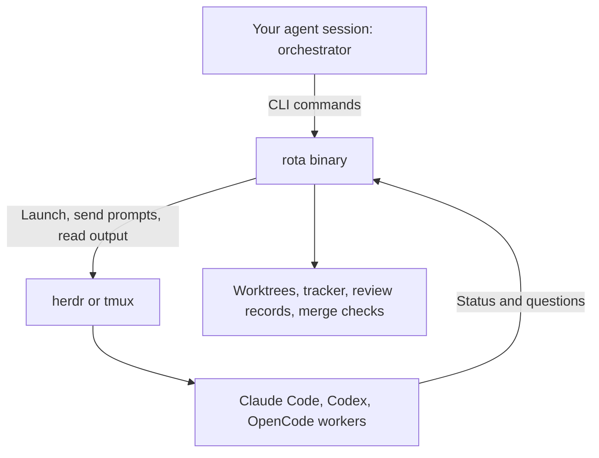

# Behind the scenes

rota combines an agent session with a Go command-line tool. The agent makes decisions; the binary manages worker sessions, worktrees, state and merge checks.

## The orchestrator calls the CLI

The orchestrator is your Claude Code, Codex or other supported [agent session](usage/orchestrator-harnesses.md), following the `rota-orchestrate` skill. It calls `rota` through its shell tool, just as a coding agent calls git or a test runner.

| Command | What the binary does |
|---|---|
| `rota round assign` | Checks readiness, assigns an issue and starts or resumes a worker in its worktree. |
| `rota worker dispatch` | Sends a brief or relays a message into a worker session. |
| `rota round watch` | Watches for worker, PR and question changes; returns a report when something changes or a heartbeat is due. |
| `rota worker gate` | Checks required reviews and approvals, tests the combined code and merges on a pass. |

These are commands the orchestrator uses internally. The [CLI reference](reference/cli-helpers.md#rota-round) covers their arguments.

## Why herdr or tmux is involved

herdr and tmux host the terminal sessions where workers run. rota uses them to launch a harness, send it instructions and read its output or status. Each worker has its own git worktree and can use a different configured account.

The tmux adapter sends input with `send-keys` and reads output with `capture-pane`. herdr also exposes agent-status events.

Without a host, Claude Code can run workers as subagents in separate worktrees. They share the orchestrator's account. [Worker setup](first-round.md) explains the choices.

## Keeping routine work out of model context

Watching sessions, checking git state and running tests happen in ordinary code. A CLI call can perform those steps and return a result, instead of asking the model to work through each operation.

`rota round watch` runs in the background. The process checks workers and the forge while the orchestrator remains available to you. With tmux, polling happens inside the binary; it does not need a new model turn for every check. `rota round wait` is the blocking alternative.

This reduces orchestration chatter and repeated terminal output in context. Coding, reviews and decisions still use your agents' tokens.

## Questions and merges come back through the orchestrator

A worker can record a question with `rota worker send`. The watcher reports it, the orchestrator asks you, then relays your answer to the worker. Issue notes and project state preserve the decision beyond that conversation.

Workers open PRs. The orchestrator calls the merge gate, which checks review records and runs the configured verification on the PR combined with current main. A failure returns to the orchestrator for action; a pass can merge under your approval policy. [Safeguards and limits](agent-mistakes.md).
