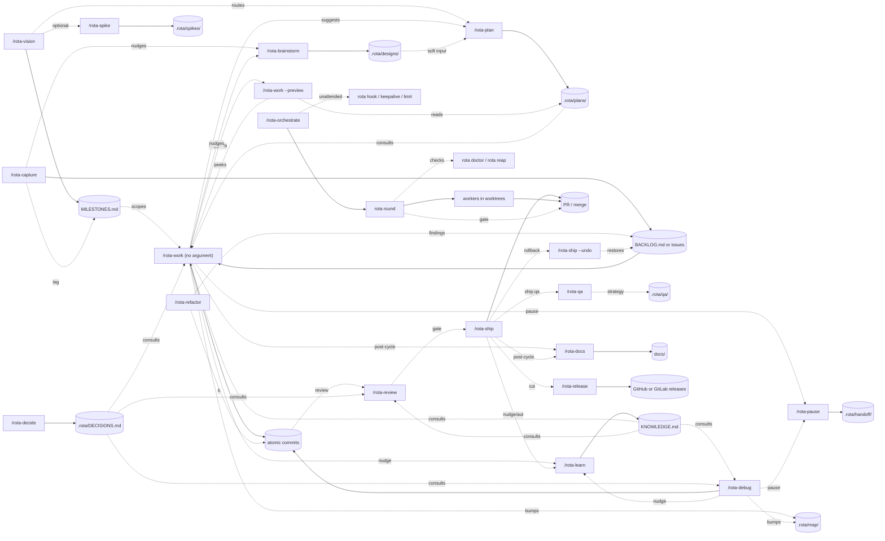

# How rota works

rota is a CLI plus a set of skills (slash commands in Claude Code). Together they form a loop: capture, plan, execute with atomic commits, ship behind a review gate, persist the lessons.

## Two ways to use it

**One agent, one item at a time.** You stay in the conversation: `/rota-capture` writes the work down, `/rota-work` builds it, `/rota-ship` reviews it and opens a PR or merges. Start here.

**A round: several agents in parallel.** For several independent issues, `/rota-orchestrate` starts a round with three roles:

- **Orchestrator**: one agent that picks the next issues, hands them out, answers workers' questions and merges.
- **Workers**: agents that each take one issue in their own git worktree, build it and open a PR. They never merge.
- **Gate** (`rota worker gate`): the only merge path. It checks the PR is current and properly signed off, runs your full test suite (`test.full`) on a scratch merge of it, then merges on a pass.

Both ways share a memory in `.rota/`: knowledge, decisions and handoff notes.

## The detailed map

Every skill, the artifacts it reads or writes, and which skills nudge or consult each other:

Almost everything Claude reads or mutates lives under `.rota/` in your project; with `issues.source` set to `github` or `gitlab` the backlog lives on the GitHub/GitLab tracker instead. Git is the source of truth; `status.json` is a cache, and `/rota-work` with no argument reconciles drift between the two.

## How skills chain

Each chain below plays out step by step, with what you type and what the agent prints, on the [Examples page](https://volkerotto.net/rota/examples/).

<!-- generated:skills:chains begin -->
<!-- edit docs/skills/*.md and run python3 scripts/skills-docs.py -->

### Fix a small bug or add a small feature

One clear item, small enough to build in one sitting.

1. [`/rota-capture`](skills/rota-capture.md): Write the item down. Capture records it and stops.
2. [`/rota-work`](skills/rota-work.md): Build it in small commits. The proof gate needs a red run, then a green one.
3. [`/rota-ship`](skills/rota-ship.md): Review the branch, then open the PR or merge.

Walkthrough: [Quickstart: one item in manual mode](walkthroughs/quickstart-manual-mode.md)

### Build a bigger feature

A Major item where the design or the approach needs sign-off before code lands.

1. [`/rota-capture`](skills/rota-capture.md): Record the feature as an item.
2. [`/rota-brainstorm`](skills/rota-brainstorm.md): Settle the design with you, section by section.
3. [`/rota-plan`](skills/rota-plan.md): Turn the design into tasks with a way to verify each.
4. [`/rota-work`](skills/rota-work.md): Build the plan, one verified task at a time.
5. [`/rota-ship`](skills/rota-ship.md): Review against what the item promised, then merge.

Walkthrough: [A round cycle: shape the slate, run the round, cut the release](walkthroughs/round-cycle.md#a-major-item-brainstorm-then-plan)

### Chase a bug you don't understand

Something is broken and the cause is not known yet.

1. [`/rota-debug`](skills/rota-debug.md): Reproduce it, test one hypothesis at a time, fix it in one commit.
2. [`/rota-ship`](skills/rota-ship.md): Review and merge the fix.
3. [`/rota-learn`](skills/rota-learn.md): Keep what the bug taught you for the next session.

Walkthrough: [Greenfield: from a brief to a shipped milestone](walkthroughs/greenfield-from-brief.md#step-7-a-real-bug-run-rota-debug)

### Try a risky idea first

You don't know yet whether an approach or a library works.

1. [`/rota-spike`](skills/rota-spike.md): Try it on a throwaway branch. Only the findings come back.
2. [`/rota-plan`](skills/rota-plan.md): Plan the real work with what the spike found.
3. [`/rota-work`](skills/rota-work.md): Build it.

Walkthrough: [Greenfield: from a brief to a shipped milestone](walkthroughs/greenfield-from-brief.md#step-3-rota-spike-optional)

### Start a project from a brief

An empty repo and an idea of where it should go.

1. [`/rota-init`](skills/rota-init.md): Suggest config values from the repo, confirmed one by one.
2. [`/rota-vision`](skills/rota-vision.md): Turn the brief into milestones.
3. [`/rota-plan`](skills/rota-plan.md): Plan the first milestone slice.
4. [`/rota-capture`](skills/rota-capture.md): Turn the plan into backlog items.
5. [`/rota-work`](skills/rota-work.md): Build the first item.

Walkthrough: [Greenfield: from a brief to a shipped milestone](walkthroughs/greenfield-from-brief.md)

### Run several issues in parallel

A few independent issues are ready and you can stay around for questions.

1. [`/rota-plan`](skills/rota-plan.md): Shape the slate so every issue has clear acceptance.
2. [`/rota-orchestrate`](skills/rota-orchestrate.md): Hand issues to workers, review their PRs, merge through the gate.
3. [`/rota-answer`](skills/rota-answer.md): Answer the decisions the round put to you, one at a time.
4. [`/rota-learn`](skills/rota-learn.md): At wind-down, keep what the round learned.
5. [`/rota-release`](skills/rota-release.md): Cut a release when the work adds up to one.

Walkthrough: [A round cycle: shape the slate, run the round, cut the release](walkthroughs/round-cycle.md)

### Stop for today

The context is filling up or you have to leave mid-item.

1. [`/rota-learn`](skills/rota-learn.md): Save the lessons worth keeping.
2. [`/rota-pause`](skills/rota-pause.md): Write a handoff so a fresh session continues.
3. [`/rota-work`](skills/rota-work.md): Next session, with no argument, it reads the handoff and picks up.
<!-- generated:skills:chains end -->

Every skill has its own page with examples and flags: [skills](skills/README.md).
