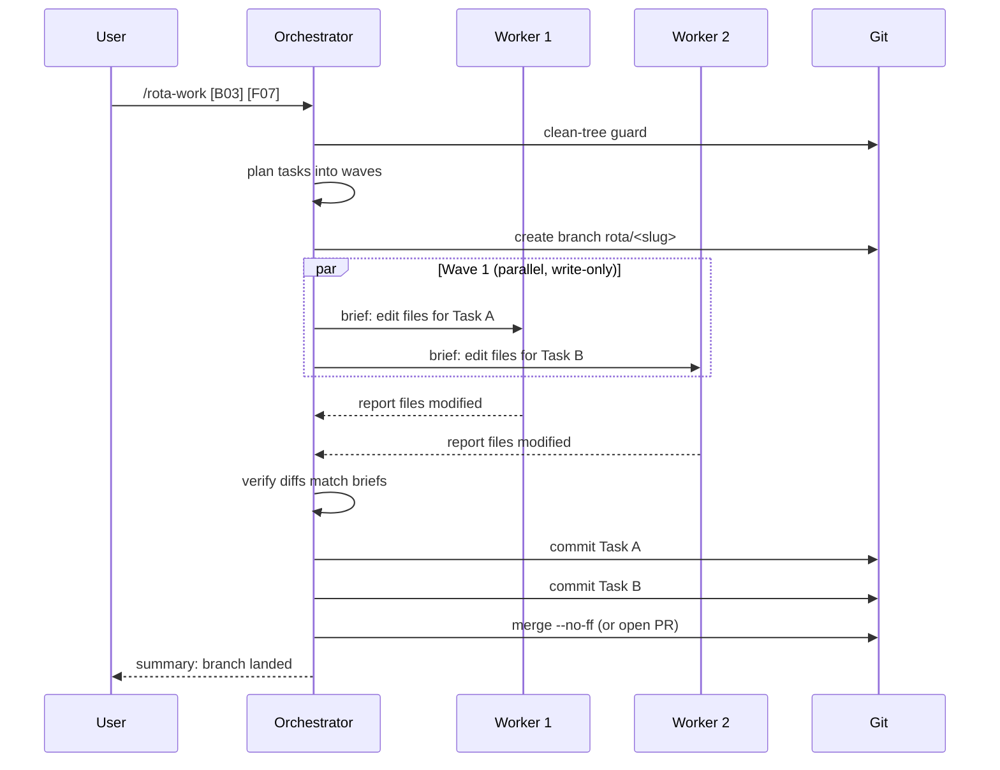

# Implementing

Items captured in the backlog ([`BACKLOG.md`](../reference/rota-folder.md), or issues on the [issue backend](issue-backend.md)) reach "merged" through `/rota-work`, an orchestrator that plans, dispatches parallel workers, and lands one atomic commit per task.

## /rota-work

The orchestrator plans tasks, dispatches workers in parallel (one per task), verifies each result, then merges to main or opens a PR per your `work.mergeStrategy`. On the issue backend it always opens a PR.

**Trigger phrases:**

- `/rota-work` with no argument reconciles the backlog, reports a round in flight or an item that failed its gate, suggests an item, then works it
- `/rota-work [B03]` to implement a specific item by ID (`/rota-work 42` on the issue backend)
- `/rota-work [B03] [F07]` to implement a batch of items together
- `/rota-work "add retry logic to the upload pipeline"` takes a brief; run `/rota-capture` first so the work has an ID to close

**Precondition:** a clean working tree. Files that tools generate beside your work (a lockfile, a codegen output) are swept into a `chore:` commit and the run continues. Any other uncommitted change of yours stops it: commit or stash first.

**Status tracking:** registers in `.rota/status.json` at start so [`/rota-work` (no argument)](picking-work.md) in another session knows those items are in progress.



## One commit per task

Each task lands as its own atomic commit. The skill doesn't fix a message format: each worker brief carries a suggested message and the orchestrator commits with it verbatim. Naming the item ID in the message (for example `[B03]`) is what lets `/rota-ship` find the item for the PR body. Commits might look like this:

```
a1b2c3d fix: retry logic on network timeout [B03]
d4e5f6a feat: per-project theme support [F07]
g7h8i9j chore: update CI to Node 20 [T02]
```

This keeps reverts surgical (drop one task without touching others) and lets you review a PR commit by commit. `/rota-ship` reads the history to build PR bodies: it lists the items whose IDs the commits name.

## Isolation: branch vs. worktree

Set `work.isolation` in [`config.json`](configuration.md):

| Mode | How it works | When to use |
|------|-------------|-------------|
| `"branch"` (default) | Feature branch in the current worktree | Solo work, simple workflows |
| `"worktree"` | Isolated directory under `.claude/worktrees/` | Parallel sessions, keep main clean while agents work |

With `"branch"`, your main worktree switches to the feature branch for the duration of the run. With `"worktree"`, the main worktree stays on `main`, so you can keep editing there while agents work in isolation.

To run multiple `/rota-work` sessions at the same time on different item batches, pick `"worktree"`. See [parallel-work](parallel-work.md) for the multi-session pattern.

## Capture, then work

For a single ad-hoc fix, run `/rota-capture` and then `/rota-work` on the printed ID.

```
/rota-capture "fix the off-by-one in RingBuffer"
/rota-capture "add a Cmd+K shortcut to the project picker"
```

The item gets a real ID (`#N` on the issue backend, `[B07]` on the file backend). Capture prints the ID and stops; it never starts work. If the scope is fuzzy, refine the item before running `/rota-work <ID>`.

## Capture vs. Work: picking the right entry

Pick by intent, not by the verb typed:

| The user wants to… | Use | Why |
|---------------------|-----|-----|
| Brain-dump items into the backlog without acting now | `/rota-capture` | Records only; no execution, no clean-tree guard |
| Get one specific thing done right now (not yet captured) | `/rota-capture`, then `/rota-work <ID>` | Capture records only; work is a separate step |
| Implement an item that's already in the backlog | `/rota-work <ID>` | Plans, dispatches workers, verifies, commits per task |
| Pick the next thing from the backlog and execute | `/rota-work` (no argument) | Reconciles, suggests, then works the pick |

**Rules of thumb:**

- *"fix X"* / *"add Y"* / *"do Z"*: clear single thing, not yet captured: `/rota-capture`, then `/rota-work <ID>`.
- A list of things, no immediate action, *"capture this"* / *"add to backlog"*: `/rota-capture`.
- Reference to an existing `[B##]`/`[F##]`/`[T##]` plus *"implement"* / *"build"* / *"do this one"*: `/rota-work <ID>`.
- *"what's next?"* / *"pick something"* / *"what should I work on?"*: `/rota-work` with no argument.

When intent is ambiguous, `/rota-capture` is the cheapest path: it only records, so nothing runs until you say so.

See [capturing work](capturing-work.md) for capture details and [picking work](picking-work.md) for how the no-argument `/rota-work` selects and prioritizes.

## Proof: what Step 7 records

After each task, `/rota-work` checks the diff against the brief, then writes proof: rows saying what ran and whether it passed.

- `rota proof record <ID> -- <command>` runs the command and writes the row itself: PASS when it exits 0, FAIL otherwise (and it exits 1 then). A row is measured, never typed. For a docs-only task with no command, `rota proof add` writes the row; its check says `no test seam: docs/skill change`.
- For a behavior change, run the new test through `rota proof record` before the change. The FAIL row is the red run. Run it again after the change for the PASS row. A test that fails on a build or setup error (missing import, undefined symbol) is not a red run; it has to fail on an assertion. Set [`work.tdd`](configuration.md#worktdd-red-first-on-or-off) to `false` to drop the red-first rule. PASS rows are still recorded.
- When `test.fast` is set, Step 7 runs `rota test run fast`, and that row is the PASS proof.
- A FAIL gets a fix dispatch, at most three per task. `rota debug work-fix attempt <ID> --task <N>` counts them across sessions and exits 4 on the fourth; `/rota-work` then stops, prints the failing rows and points at `/rota-debug <ID>`. A PASS clears that task's count only; only a human reset (`rota debug work-fix reset`, a manual gate) lifts the cap.
- If the issue's body has a `## Acceptance` list, each line carries an id (`AC-1`, `AC-2`, ...). `rota item complete` closes an item only when it has proof and exits 4 otherwise. On the issue backend, a plan's tasks name the ids they deliver (`Serves: AC-1`), and `rota plan pass <key> <AC-id> --proof <sha>:<check>` marks a criterion met by one proof row. See [vision and plans](vision-and-plans.md#rota-plan-write-the-implementation-plan).

## Merge or PR

After `/rota-work` finishes, `work.mergeStrategy` in `config.json` controls what happens next:

| Strategy | Behavior |
|----------|----------|
| `"direct"` (default) | Merges the branch to main with `--no-ff`, deletes the branch |
| `"pr"` | Pushes the branch and opens a GitHub PR or GitLab MR with a summary |

On the issue backend the strategy is treated as `pr`, the PR closes the issues when it merges, and `/rota-work` never merges (`/rota-review --queue` does). Ship-time gates (review, second opinion, QA, PR body composition) are in [review and ship](review-and-ship.md).

## Many items at once

`/rota-work` takes items one session at a time, with subagents inside that session. To run several issues in parallel, each worker in its own worktree and terminal tab, use a round: run `rota doctor`, then ask for `/rota-orchestrate`. See [parallel rounds](parallel-rounds.md), the [`rota round` verbs](../reference/cli-helpers.md#rota-round) and [`/rota-orchestrate`](../skills/rota-orchestrate.md).
