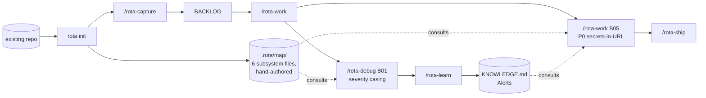

# Brownfield: what rota adds to an existing project

You have a codebase you have maintained for months or years, an informal list of bugs, some open GitHub issues you haven't gotten to, and a vague sense that the same gotchas keep recurring. This page shows what is on disk once rota is wired into the project, your bugs are captured, one is shipped and a first lesson sits in `KNOWLEDGE.md`.

The commands and their output are on the Examples page: [Bring rota into an existing project](https://volkerotto.net/rota/examples/#existing-project). This page keeps what a transcript cannot show: the config choices, the project map, the backlog, a decision and a knowledge entry.

The example project is **Pinpoint**, an internal incident dashboard. Node and React, deployed as a single container. It has been in production for 18 months, with 14 open GitHub issues, 30-odd `TODO` comments scattered through the source and three bugs you keep meaning to fix.

## The shape of the walkthrough



## Step 1: rota init

```bash
$ rota init
```

The defaults match a greenfield setup. For an existing repo, consider flipping two with `rota config set`: `worktree` isolation so `main` stays untouched while agents run (useful when you also need to deploy from `main` mid-cycle), and `pr` merge strategy if your team requires GitHub review. For a solo maintenance pass, the defaults are fine.

`rota init` writes `.rota/` and the managed blocks in `AGENTS.md` (`CLAUDE.md` imports it). It doesn't read your code.

## Step 2: Scaffold the project map

`/rota-work` and `/rota-debug` need to know what subsystems your project has so they don't burn context re-exploring the same directories on every cycle. The project map lives in `.rota/map/<name>.md`: one Markdown file per coherent area of the codebase, by hand or drafted for you. `rota init` already created the empty `.rota/map/` directory in Step 1; you fill it in now. To have the code read for you, run `/rota-refactor --map` (the [existing-project example](https://volkerotto.net/rota/examples/#existing-project) shows a run): it drafts one file per subsystem (entry points, stack, conventions, test commands, concerns), shows which files are new and which already exist, writes only what you approve (never overwriting without asking) and runs `rota map index`. The sketch below is what you'd write by hand, or end up with after editing the draft.

For Pinpoint you spend ten minutes sketching out:

```
.rota/map/
  api.md           server/api/*           (Express routes, request validation)
  dashboard.md     web/src/dashboard/*    (React dashboard pages)
  alerts.md        server/alerts/*        (rule engine, dedup, escalation)
  integrations.md  server/integrations/*  (Datadog, PagerDuty, Slack)
  storage.md       server/storage/*       (Postgres pool, migrations)
  shared.md        shared/*               (cross-cutting types, utils)
```

A typical file:

```markdown
---
subsystem: alerts
summary: Rule engine that ingests events, dedups, and escalates to integrations.
touched: 2026-05-16
created: 2026-05-16
last_mapped_commit: 3f9c2ab41d7e5a60b8c1d2e9f04a7b6c5d3e8f12
---

## Purpose
Rule-based alerting. Reads events, evaluates rules, dedups within a window, and escalates via integrations.

## Entry points
- server/alerts/engine.js:14 — main rule loop
- server/alerts/dedup.js:8 — dedup key + window logic

## Key files / dirs
- server/alerts/

## Conventions specific here
- Severity is normalized at the integration boundary, not at storage time.

## Notes / gotchas
- Dedup window is hardcoded; per-rule windows are on the backlog.
```

Run `rota map index` once after writing the files; it pulls each file's `summary:` into the always-on `## Project Map` block in `AGENTS.md`. The map isn't exhaustive; just enough for the orchestrator to know where to look. After every `/rota-work` cycle, touched subsystems get their `touched:` date bumped automatically and the always-on block is regenerated. `last_mapped_commit` is the commit a file was written against, which `/rota-refactor --map` fills in. `rota map stats` counts the commits since and prints a `note:` for each subsystem more than `map.staleCommits` (default 50, `0` turns it off) behind HEAD; it never fails. Re-run `/rota-refactor --map` to refresh. When subsystems drift or duplicate later, edit or retire the relevant `.rota/map/<name>.md` files by hand.

## Step 3: open issues (optional)

If your project already tracks work in GitHub or GitLab issues, use the issue backend: `rota config set issues.source github`. The open issues already are the backlog, so there is nothing to import. See [issue backend](../usage/issue-backend.md). If you have no tracker, or want the backlog in the repo, stay on the file backend and capture what you care about with `/rota-capture` (Step 4).

Pinpoint stays on the file backend for this walkthrough, so the IDs read `[B01]` instead of `#N`. The five issues worth tracking went in with one `/rota-capture` call, the way Step 4 does it; they became `B01` to `B05`.

## Step 4: /rota-capture for the mental backlog

The remaining items, the ones you've been tracking informally, go in via `/rota-capture`. Brain-dump in one go; the model splits, classifies, and assigns IDs. The IDs and files below are the file backend's; on the issues backend each item is an issue and its ID is `#N` ([issue backend](../usage/issue-backend.md)). The call and its output are in the [existing-project example](https://volkerotto.net/rota/examples/#existing-project).

Four items come out: `B06` (crash on empty title, P1), `F01` (a `/health` endpoint, Minor), `F02` (per-rule dedup window, Major) and `B07` (the DST off-by-one, P1). Detail files at `.rota/bugs/B06.md` etc. hold the long-form description for items that overflow the one-line BACKLOG row.

F02 is size-Major and touches several subsystems, so `/rota-capture` nudges you toward `/rota-brainstorm F02` before `/rota-plan`, for design negotiation, not implementation. You take the nudge: the session ends with two competing approaches weighed and a sectioned design approved, saved at `.rota/designs/F02.md`. When `/rota-plan F02` runs later, it reads that file as soft input rather than re-deriving the design.

## Step 5: /rota-work surveys everything

Plain `/rota-work` reconciles `status.json` against the repo, archives completions older than five days and shows the whole backlog sorted: bugs P0 to P2, then features Major to Cosmetic, with F02 flagged as having a design on disk. It suggests `B05`, the P0 secrets-in-URL bug, and P0 always wins.

## Step 6: a hot-path fix that skips the queue

Before you commit to B05, you spot a typo in the contributing guide. Too small to queue: `/rota-capture` mints `[T01]` and stops, and `/rota-work T01` dispatches a worker, lands one commit on a feature branch and merges back in about thirty seconds.

## Step 7: the P0 cycle

Back to B05. The integration config UI accepts secrets in a URL query string field instead of routing them through a password input. They end up in browser history and access logs.

`/rota-work B05` reads B05's detail file, queries `KNOWLEDGE.md` for the `Security` topic (empty so far) and reads `.rota/map/integrations.md` for entry points, then decomposes the fix into four tasks: render secrets through `type="password"`, reject secrets in the URL query on the POST endpoint, scrub known secret patterns from existing access logs, update the docs. Each task has its own verify step. The session is in the [existing-project example](https://volkerotto.net/rota/examples/#existing-project).

Four tasks, four commits, all on `rota/B05-secrets-in-url-form`. Worktree isolation keeps `main` clean. The branch merges back via `--no-ff`, so the cycle is one revertable unit.

## Step 8: a real debug cycle

Two days later you tackle B01, the dedup-fires-twice issue. `/rota-work B01` dispatches a worker, the worker writes what looks like a fix, and the verify step fails with two events still delivered. `/rota-work` recommends `/rota-debug B01`, and you take the nudge. The cycle reproduces the failure, finds that `dedupKey` is built from `rule_id + entity_id + severity` while the two integrations send different casing (`"high"` against `"HIGH"`), confirms that by assertion, then lowercases severity in the key computation. One commit: `fix(alerts): normalize severity casing in dedup key [B01]`. The session is in the [existing-project example](https://volkerotto.net/rota/examples/#existing-project).

`/rota-debug` ends by nudging `/rota-learn`. The bullet that lands under `## Alerts` in `KNOWLEDGE.md`:

```markdown
## Alerts

- **Severity is case-sensitive in the dedup key path.** External integrations send inconsistent casing for severity (Datadog sends `high`, PagerDuty sends `HIGH`). Normalize at the boundary, not at storage time. The dedup gate runs before normalization. Fix once at the integration layer, or accept that the bug-class returns.
```

This bullet now travels with every future `/rota-work` and `/rota-debug` cycle in the `alerts` or `integrations` subsystems: the orchestrator pulls it into its planning context automatically.

## Step 9: /rota-ship

When the branch is ready, `/rota-ship` runs `/rota-review`, which returns `PASS` for the B01 fix, and ship builds a PR body from the commit subjects and resolved IDs and opens the PR via `gh`. B01 was already moved to `## Completed` in `BACKLOG.md` when `/rota-debug` closed it on the file backend, stamped with the fix commit's hash; the merge changes nothing in the backlog.

If you'd configured `work.mergeStrategy = direct` instead, `/rota-ship` would have merged into `main` directly. On the issue backend, the PR body would carry `Closes #N` and GitHub would close the issue on merge.

## Step 10: over the next week

After a week of dropping rota into Pinpoint:

- `BACKLOG.md` has 11 items from the captured bugs and the brain-dump; six are shipped, two in flight, the rest queued
- `KNOWLEDGE.md` has four to six bullets across `Alerts`, `Storage`, `Integrations`, and `Security`. Surprises worth keeping, not a fix log
- `.rota/map/` has six subsystems, three of them `touched: 2026-05-19` (this week) and three older
- `DECISIONS.md` has one hard boundary you committed to mid-cycle: *"Secrets are never accepted via URL query params on any integration endpoint. Forbids: query-string POST bodies. Permits: form bodies with `type=password` inputs."* Future workers must respect it; the orchestrator surfaces it during planning if a touched file is in scope.
- Optionally one milestone, e.g. `M01 — security hardening`; brownfield works without one.

Over time the same class of gotcha stops recurring. Three months from now, when a teammate ships a new integration and trips the severity-casing bug, the next `/rota-work` cycle pulls the `## Alerts` knowledge bullet into context and the orchestrator flags it during planning, before any code lands.

## What changes structurally

Adopting rota needs no refactoring. The only structural addition is `.rota/` (tracked by default, with a few machine-specific paths gitignored) and a managed block in `AGENTS.md`. Your existing build, tests, deploy pipeline, and code layout stay the same. The map and the knowledge accumulate from how you already work (debug, fix, ship); the loop now leaves a trace that future cycles consult.

## Scale to a round

With several independent, well-specified items in the backlog, a [parallel round](../usage/parallel-rounds.md) has an orchestrator hand issues to workers in separate worktrees and merge what passes the gate. Use it for a queue of issues that don't touch the same files; keep `/rota-work` for the handful you are watching.
