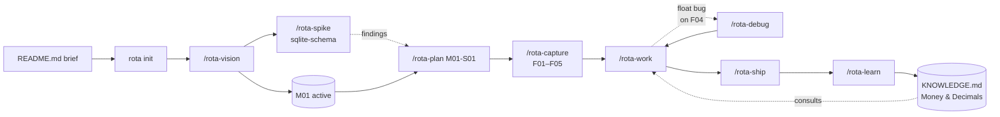

# Greenfield: what a project holds after a brief

You have an idea, a one-page brief, and an empty repo. This page shows what is on disk once rota has taken it to a shipped milestone: a roadmap, a slice plan, a backlog, code in `main` and durable knowledge for the next session.

The commands and their output are on the Examples page: [Start a project from a brief](https://volkerotto.net/rota/examples/#new-project), [Try a risky idea first](https://volkerotto.net/rota/examples/#risky-idea) and [Chase a bug you don't understand](https://volkerotto.net/rota/examples/#unclear-bug). This page keeps what a transcript cannot show: file contents, config choices and the arc over several weeks.

The project carried through every step is **Tally**, a self-hosted household budget tracker. CLI first, web dashboard later. The brief lives at the project root as `README.md`:

```markdown
# Tally

A self-hosted budget tracker for a household. CLI-first so I can pipe transactions in from bank exports. Eventually a small web dashboard so my partner can use it without learning the CLI. Single binary preferred. Privacy is the point — no cloud sync.

Must-haves: capture transactions (date, amount, category, note), monthly category rollups, year-over-year compare. Nice-to-have: budget vs actual alerts.

Constraints: I want to dogfood this within two weeks. Postgres or SQLite, no decision yet. Go or Rust, leaning Go.
```

The repo has only the README and a `.gitignore`.

## The shape of the walkthrough



## Step 1: rota init

```bash
$ rota init
```

It asks no questions. The defaults fit a solo greenfield: orchestrator `opus` and worker `sonnet`, branch isolation, direct merge, review gate on, autonomy off. Flip any of these later with `rota config set`.

The command writes:

- `.rota/BACKLOG.md`, `KNOWLEDGE.md`, `DECISIONS.md`, `MILESTONES.md`, `MAP.md`
- `.rota/counters.json`, `config.json`, `status.json`, `repos.json`
- `.claude/agents/rota-{explorer,implementer,reasoner}.md`, the subagent definitions workers use (`--no-blocks` skips them)
- Managed blocks in `AGENTS.md` (`CLAUDE.md` imports it) so the orchestrator picks up project knowledge, decisions, the map, and the active milestone

Most of `.rota/` is tracked by default, so the backlog and learnings travel with the repo from the first commit. Only `.rota/status.json`, `.rota/repos.json`, `.rota/config.local.json`, `.rota/handoff/`, `.rota/review/`, `.rota/qa-runs/`, `.rota/verdicts.json`, `.rota/gate-audit.jsonl`, `.rota/train-cache.json`, `.rota/workers.json`, `.rota/receipts.json`, `.rota/**/knowledge-hits.jsonl`, and `.rota/**/*.lock` files are gitignored.

## Step 2: /rota-vision

`/rota-vision` turns "I have an idea" into "I have milestones I can execute against." It runs Socratic discovery, then web research, then a critique pass; see the [new-project example](https://volkerotto.net/rota/examples/#new-project) for how a session reads.

```bash
$ /rota-vision
```

It reads `README.md` and any stack file (`package.json`, `go.mod`, `Cargo.toml`, …) at the project root before asking anything, and finds the brief on its own: a plan-shaped `README.md`, or a file named like `brief.md`, `spec.md` or `concept.md`, that no milestone covers yet. A brief under an unrelated name (`pitch.md`, `idea.md`) is still found when its first heading reads as a plan; otherwise point at it in the opening message.

Two things in the Tally session changed the plan. The interview pinned "dogfood within two weeks" down to a working CLI used daily before anyone else sees it. The critique pass pointed out that single binary, privacy and household scale all favour SQLite over Postgres, and you committed to it. After two or three rounds of back and forth you end up with:

```markdown
# Milestones

Privacy-first household budget tracker. CLI as the daily driver, web dashboard for non-technical users. Single binary, SQLite storage. Dogfood gate: maintainer uses it daily for two weeks before adding the dashboard.

## Active milestones

- **M01** — CLI MVP (depends: —)
  CSV import, transaction capture, monthly rollups, YoY compare.

- **M02** — Web dashboard (depends: M01)
  Read-mostly browser UI sharing the same SQLite file. Partner-usable.

- **M03** — Budget alerts (depends: M01)
  Threshold-based notifications. CLI flag plus optional system notification.
```

Plus three detail files at `.rota/milestones/M01.md`, `M02.md`, `M03.md`, each with goal, acceptance criteria, rationale, risks, and the research findings from the session.

`/rota-vision` marks M01 active and seeds the always-on `## Project Vision` block in `AGENTS.md`. Later skills read the active milestone from it.

## Step 3: /rota-spike (optional)

The vision session named one unknown: how to design the transaction schema for multi-currency. The brief doesn't require it, but you suspect you'll add it within a year. `/rota-spike will a single-currency schema survive a later move to multi-currency?` names the spike `sqlite-schema` and creates a `spike/sqlite-schema` branch (which never merges into `main`) and `.rota/spikes/sqlite-schema.md` with the question recorded. See the [risky-idea example](https://volkerotto.net/rota/examples/#risky-idea). You experiment on the branch: try two schemas, write a sketch migration. When you're done, fill in *Findings* and *Decision* in the spike file:

```markdown
**Findings.** A `currency` column added later with default `'USD'` and a backfill works fine; the rollup queries need a one-line change. No data loss.

**Decision.** Ship single-currency in M01. Add `currency` column in M03 or later, no need to engineer it in advance.
```

Then run `rota spike finish sqlite-schema` to stamp it done.

For a brand-new project you might do zero spikes. Use them when the answer materially changes the design.

## Step 4: /rota-plan M01-S01

`/rota-plan M01-S01` runs a focused session on goal, approach, task decomposition, named assumptions and open questions. The planning dial it picks, and the confirm step, are in the [new-project example](https://volkerotto.net/rota/examples/#new-project). The output lives at `.rota/plans/M01-S01.md`:

```markdown
---
key: M01-S01
milestone: M01
unit: S01
title: Storage foundation and transaction capture
status: draft
created: 2026-05-13
---

## Goal

Stand up the SQLite schema and the `tally add` command end-to-end so the rest of M01 builds on a working data layer.

## Approach

Single binary, `cobra` for the CLI, `database/sql` plus `mattn/go-sqlite3`. Decimal math via `shopspring/decimal`. Migrations as embedded SQL files via `embed`. Each command opens the DB lazily.

## Tasks

1. **Skeleton CLI** — `cmd/tally/main.go`, `cmd/tally/root.go`. `tally --version` prints, `tally help` lists commands. Verify: `go test ./... && tally --version | grep v0.0.0`.
2. **Migrations engine** — `internal/store/migrate.go` plus `migrations/001_init.sql`. `tally init` creates the DB at `$XDG_DATA_HOME/tally/tally.db` and runs migrations idempotently. Verify: run twice; second run is a no-op.
3. **Transactions table** — schema covers `id`, `date`, `amount_minor`, `category`, `note`. Amounts stored as int64 minor units (cents). Verify: insert/select round-trips `decimal.NewFromString("12.34")` cleanly.
4. **`tally add` command** — flags `--date`, `--amount`, `--category`, `--note`. Validates decimal precision (max 2 places). Verify: `tally add --amount 12.345 --category food` exits non-zero with a clear error; `tally add --amount 12.34 --category food` exits 0 and the row appears in `tally list`.
5. **`tally list` command** — basic select with date range filter (`--since`, `--until`). Verify: ordering deterministic by `date ASC, id ASC`.

## Assumptions

- Solo use for M01; concurrent writes are not a concern.
- XDG paths on Linux only; Windows/macOS deferred to M02.
- `cobra` chosen for ecosystem familiarity; would re-evaluate at M03 if alerts need a different flag system.

## Open questions

- None blocking. Multi-currency deferred per the sqlite-schema spike.
```

`/rota-work` consults this plan when it dispatches. A task with no verify step is not well-defined.

## Step 5: /rota-capture

You can run `/rota-work` against the plan directly (it decomposes the same way), or capture the slice as backlog items first so each gets an ID, a detail file, and a KNOWLEDGE.md link. This walkthrough captures: the IDs allow tracking, and `/rota-work` (no argument) surfaces items in order. One `/rota-capture` call with the five task names becomes `F01` to `F05`, all Minor features tagged `Milestone: M01`.

Each gets a row in `BACKLOG.md` under `## Features`. Detail files live at `.rota/features/F01.md` … `F05.md` (auto-created when the description is long enough to overflow the BACKLOG row). With `issues.source` set to `github` or `gitlab` each item is an issue on the tracker instead; see the [issue backend](../usage/issue-backend.md).

If any of these had been size-Major instead of Minor, `/rota-capture` would have nudged you toward `/rota-brainstorm` before plan to negotiate the design first. Minor items skip that layer.

## Step 6: first cycle (/rota-work → /rota-ship → /rota-learn)

`/rota-work` with no argument suggests F01, the head of the M01 dependency chain. The orchestrator reads `.rota/plans/M01-S01.md`, picks the F01 task and dispatches a worker on `rota/F01-tally-cli-skeleton` (branch isolation). The transcript is in the [new-project example](https://volkerotto.net/rota/examples/#new-project).

What lands on disk: one commit per task (`feat(cli): scaffold tally root command [F01]`), a proof row per verify step, F01 marked done in `BACKLOG.md`. `/rota-work` merges the branch into `main` with `--no-ff` (direct merge), deletes it, and prompts for the next item.

You repeat for F02 and F03. F03 introduces a subtle bug. The transactions schema stores amounts as int64 minor units, but the worker's helper converts `decimal.Decimal` to int64 by multiplying by 100 and casting, which looks right and is wrong.

## Step 7: a real bug, run /rota-debug

F04 lands, and a quick smoke test shows `tally add --amount 0.10` stored as `0.09`: a float intermediary. `/rota-debug` reproduces it with a failing `TestAmountRoundTrip`, tests one hypothesis (the helper multiplies `Float64()` by 100, and `0.10` times 100 is `9.999…`, which truncates to `9`), confirms it before touching code and fixes it with `decimal`'s own `Shift(2)`. The session is in the [unclear-bug example](https://volkerotto.net/rota/examples/#unclear-bug).

What lands on disk: one atomic commit, `fix(money): use decimal.Shift instead of Float64 for minor-unit conversion`, plus a proof row for the reproducer. The bug sat in F03's helper, not in `add`, which is why you point `/rota-debug` at F04 and let it trace back. `/rota-debug` ends by nudging `/rota-learn`, which you take in Step 9.

## Step 8: /rota-ship

When F05 lands the slice is functionally complete:

```bash
$ /rota-ship
```

`/rota-ship` runs `/rota-review` first, then merges or opens a PR; the flow is in the [unclear-bug example](https://volkerotto.net/rota/examples/#unclear-bug). For M01-S01 the verdict is `PASS` with one `CONCERNS` note attached: *"F05 uses `fmt.Println` for output; consider `cmd.OutOrStdout()` for testability when the web dashboard imports the same package in M02."* You file that as a follow-up via `/rota-capture` and continue.

The merge goes into `main` or becomes a GitHub PR, depending on `work.mergeStrategy` (the issue backend always opens a PR). Solo mode for Tally is direct merge.

## Step 9: /rota-learn

The float-bug session produced one durable insight. `/rota-learn` (see the [unclear-bug example](https://volkerotto.net/rota/examples/#unclear-bug)) keeps only durable bullets (`--strict` adds an Opus verifier pass). It skips "fixed the bug" but writes:

```markdown
## Money & Decimals

- **Never multiply a `decimal.Decimal` by a float to convert to minor units.** `Float64() * 100` produces `9.999…` for inputs like `0.10`; truncation gives `9`. Use `decimal.NewFromString(...).Shift(2).IntPart()` end-to-end. The float path is silently wrong, not noisy.
```

The topic shows up in the `## Project Knowledge` block in `AGENTS.md`. Next time `/rota-work` touches money handling, the orchestrator pulls this section via `rota knowledge query "Money & Decimals"` before planning, so the same trap doesn't bite a worker again.

## Step 10: repeat, then close M01

You loop steps 6 to 9 through additional slices: `tally summary` for monthly rollups, `tally yoy` for year-over-year compare, a CSV importer. Each `/rota-plan M01-S02`, `M01-S03`, `M01-S04` writes its own slice plan; `/rota-capture` seeds items; `/rota-work` ships them; `/rota-learn` catches anything subtle that surfaced.

After the importer ships, `/rota-work` (no argument) flags the empty milestone in its orientation output as `empty-active: M01`. You close it with `rota milestone status M01 --to shipped`. M02 and M03 (which both depend on M01) flip from blocked to ready in `MILESTONES.md`. The next `/rota-vision` invocation enters edit mode and refines M02's plan with what you learned in M01. The float gotcha now informs the dashboard's number rendering, and the XDG-paths-Linux-only assumption gets revisited for cross-platform packaging.

## What you have after two weeks

- `main` has one commit per task, each verifiable in isolation
- `.rota/MILESTONES.md` shows M01 shipped, M02 active
- `.rota/KNOWLEDGE.md` carries five to ten bullets across three or four topics; learnings, not a fix log
- `.rota/plans/` keeps the M01-S01 plan on disk (slice plans persist; item-specific plans are auto-cleaned on ship)
- `.rota/spikes/sqlite-schema.md` is a permanent record of why M01 stayed single-currency

The next session in a fresh `/clear` starts from `/rota-work` (no argument), which reads the active milestone, the open backlog, and the managed blocks in `AGENTS.md`. Nothing important lives only in your head: it is on disk, and the orchestrator's planning context starts with what you learned.

## Scale to a round

With several independent, well-specified items in the backlog, a [parallel round](../usage/parallel-rounds.md) has an orchestrator hand issues to workers in separate worktrees and merge what passes the gate. Use it for a queue of issues that don't touch the same files; keep `/rota-work` for the handful you are watching.
