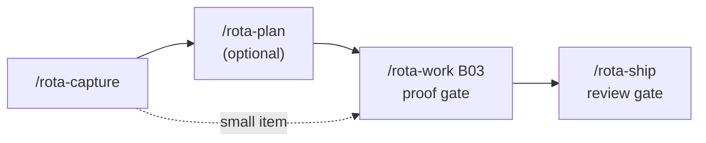

# Quickstart: one item in manual mode

One small bug, from capture to merge, with you driving each step. No round, no orchestrator agent, no workers in other tabs. The longer walkthroughs ([greenfield](greenfield-from-brief.md), [brownfield](brownfield-existing-project.md)) cover whole projects; this one shows the loop on a single page.

The example is a bug in a small CLI: `--limit 0` prints every row instead of none. It uses the default file backend, so IDs read `[B03]`. On the [issue backend](../usage/issue-backend.md) the same item is an issue and its ID is `#N`.



## Step 1: capture

```
/rota-capture "--limit 0 prints every row instead of none"
```

```
[B03] --limit 0 prints every row instead of none   Bug, P2
```

What changed: a new row under `## Bugs` in `.rota/BACKLOG.md`. Capture records and stops; it never starts work. See [capturing work](../usage/capturing-work.md).

## Step 2: plan (optional)

```
/rota-plan B03
```

The skill reads the item, `KNOWLEDGE.md` and `DECISIONS.md`, states a planning level and shows the plan unsaved:

```
Goal: --limit 0 yields zero rows.
T1. Treat 0 as a real limit in cmd/list.go.
    Verify: go test ./cmd -run TestListLimitZero
Confirm this plan? (yes / changes)
```

Say `yes` and the plan is written to `.rota/plans/B03.md`. On the issue backend it becomes a note on the issue.

**Skip this step for an item this small.** `/rota-work` plans its own tasks from the item. Run `/rota-plan` when the approach needs sign-off before code lands, or the item is too big to one-shot. See [vision and plans](../usage/vision-and-plans.md).

## Step 3: work

```
/rota-work B03
```

The orchestrator checks the tree is clean, creates a branch (`rota/B03-limit-zero`), dispatches a worker for each task and checks each diff against its brief. One commit per task, naming the ID:

```
a1b2c3d fix: treat --limit 0 as zero rows [B03]
```

**The proof gate sits here.** Each task writes proof rows. For a behavior change the test runs first and must fail on an assertion, then pass:

```
rota proof record B03 -- go test ./cmd -run TestListLimitZero    # FAIL: the red run
rota proof record B03 -- go test ./cmd -run TestListLimitZero    # PASS
```

`rota item complete` closes an item only when it has proof, and exits 4 otherwise. A docs-only task has no red run. See [running work](../usage/running-work.md#proof-what-step-7-records).

What changed: a feature branch with one commit per task, a proof row per check, and B03 marked in progress in `.rota/status.json` until it lands.

## Step 4: ship

```
/rota-ship
```

`/rota-ship` runs `/rota-review` first. It is read-only: a Spec reviewer checks the diff against what B03 promised, a Standards reviewer checks conventions and test quality, and the worse verdict wins.

**The review gate sits here.**

| Verdict | What ship does |
|---------|----------------|
| `PASS` | Integrates automatically. |
| `CONCERNS` | Shows them; you proceed or fix first. |
| `FAIL` | Stops until you fix the branch and rerun. |

On `PASS`, ship builds the PR body from the commit subjects and the IDs they name, then integrates. With `work.mergeStrategy` set to `direct` (the default) it merges into `main` with `--no-ff` and deletes the branch. With `pr` it pushes and prints the PR URL. On the issue backend it always opens a PR whose body carries `Closes #N`, and the merge closes the issue. Opt-in extra gates (`ship.secondOpinion`, `ship.qa`, `ship.uat`) run between review and merge when enabled. See [review and ship](../usage/review-and-ship.md).

What changed: B03 sits under `## Completed` in `BACKLOG.md`, stamped with the fix commit's hash, and `main` carries the fix as one revertable unit.

## Where next

- Several independent items queued: run a [parallel round](../usage/parallel-rounds.md).
- A fix that will not stay fixed: [`/rota-debug`](../usage/debugging.md).
- A surprise worth keeping: [`/rota-learn`](../usage/learning.md).
