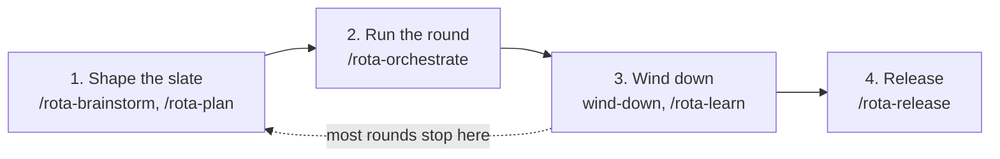

# A round cycle: shape the slate, run the round, cut the release

[Your first round](../first-round.md) gets a round running, and [parallel rounds](../usage/parallel-rounds.md) documents every verb. This page is the loop a maintainer repeats between releases: shape the slate, run an orchestrated round, wind down, and sometimes release.

It assumes the host is set up and `rota doctor` is green. One item without a round is the [manual-mode quickstart](quickstart-manual-mode.md). The issue numbers below are made up, for a project with a backlog on GitHub issues.



Each stage below names the decision you make and the artifact it leaves.

| Stage | Decision | Artifact |
|---|---|---|
| 1. Shape the slate | Slate size and order; which items need design or a plan | design note, plan note, acceptance on each issue |
| 2. Run the round | Overlap, bounce or fix, merge order | PRs on the base branch |
| 3. Wind down | What is worth keeping | `rota round summary` table, `KNOWLEDGE.md` entries, docs edits |
| 4. Release | Whether to release now; bump level | `CHANGELOG.md` entry, tag, published release |

## 1. Shape the slate

A worker boots with no context beyond its issue, so the issue is the spec. A round only offers issues with acceptance criteria, a design note or a plan note, and the time you spend here pays back in fewer bounces.

Look at what is open and decide how many items the round takes. Three or four workers' worth is plenty for a first slate: every merged PR is a diff you read.

```bash
rota round candidates      # open items with their readiness checks
```

### A Major item: brainstorm, then plan

A Major feature or a P0 bug with an unclear shape gets a design first:

```text
/rota-brainstorm 42
```

It negotiates whether this is the right thing and what shape it takes, and stores the result as the item's design (a note on the issue, `.rota/designs/<ID>.md` on the file backend). Your decision: which of the approaches it laid out you accept. See [brainstorming a design](../usage/brainstorm.md).

Then the plan:

```text
/rota-plan 42
```

`/rota-plan` rates the item on how costly, how hard to undo and how invisible a wrong plan would be, picks a planning level and says which in one line. At level 4 (the adversarial pass) a grilling pass and a plan critic argue against the finished plan before you sign it off; the critic's findings land in the plan's `## Critic findings`. Use that level for the risky items, such as a migration, a published format or a gate rule. Your decision: override the level in a word if it is wrong, and settle the critic's open questions. See [vision and plans](../usage/vision-and-plans.md#rota-plan-write-the-implementation-plan).

The plan ties every task to an acceptance criterion. Check it before anything is assigned:

```bash
rota plan check '#42'
```

It exits 1 when a criterion has no task or a task has no verify step.

### A thin bug: add acceptance

A bug captured as one sentence has no acceptance, so the round will not offer it. Add the criteria to the issue as checkboxes (`- [ ] AC-1: ...`), name the files or symbols it touches under `## Touches`, and list what it must not change under `## Out of scope`. A worker may only dispute the ticket, not widen it, so the out-of-scope list is what keeps a bug fix from becoming a refactor.

### Order and overlap

Two issues that edit the same file or name the same `## Touches` entry clash. Read both bodies before you run them side by side: the overlap check cannot see files an issue will create or two issues editing the same function. If two items clash, put one in this round and one in the next. Put the item that others depend on first, and record it with `## Depends on`.

### Skip this stage when

- The item is a small fix with an obvious shape. Capture it with acceptance and go to stage 2; no brainstorm, no plan.
- You already know the design. Go straight to `/rota-plan`, or to the round.

## 2. Run the round

Start the orchestrator from the host pane (see [first round](../first-round.md#10--launch-the-orchestrator)):

```bash
rota orchestrate
```

Tell it the slate, for example "run a round on issues 42, 51, 58 and 63". Under the hood it runs:

```bash
rota round start --scope slate --items 42,51,58,63
rota round assign 42      # claims the issue, cuts <agent>/42-<slug>, starts a worker
```

`rota round assign` refuses an item that is not ready, overlaps an in-flight slot or has no free slot, and prints why. It marks nothing when it refuses. Your decision here is whether to override an overlap (`--accept-overlap`) or wait.

### Watch

You do not poll. The orchestrator waits on `rota round wait` (or runs `rota round watch` in the background) and wakes when a slot is done, blocked or dead:

```bash
rota round status          # every slot, its PR and drift
```

A slot is free as soon as its worker opens a PR, so the next issue starts while that PR waits for review. A worker that cannot decide prints `ROTA-BLOCKED` with one question. Answer on the issue or PR thread, or type `m: <answer>` in the pane.

### Review, then bounce or fix

Workers open PRs and never merge. For each PR, read the diff against the issue's acceptance criteria and its `## Approvals`, `## Rulings` and `## Assumptions` sections, then run `/rota-review` on it. Record the result on the PR's branch; a FAIL verdict blocks the gate.

Your decision, per PR:

- **Bounce it** when the worker misread the issue or skipped a stated criterion: the worker can learn from it. Count it, then relay the comments:

  ```bash
  rota round bounce 42 --head <sha>
  rota round review-relay <slot>
  ```

  Only blocking findings count as a bounce. File the rest in one follow-up item per PR (floor: `review.fileDeferred`) with `rota verdict add --file-deferred --pr <pr-ref>` instead of relaying them.
- **Fix it yourself** when the gap is one line and a round trip costs more than the fix. A fix you push still needs an independent reviewer.
- **Dispute the ticket** when the worker is right that the issue is wrong. Edit the issue, not the worker.

At `round.freshAt` (default 2) a bounce moves the branch to a fresh slot, so the second attempt does not carry the first one's context. At `round.maxBounces` rota stops relaying and escalates on the PR. Do not bounce it again: audit the acceptance criteria first, since a criterion with two readings produces the same wrong PR every time. If one is ambiguous, hand the issue to a human (`rota round transfer <issue> --to human --cap-reason ambiguous-criteria --note-file <audit>`). If they all hold, hand it to a stronger worker (`rota round transfer <issue> --to <slot> --tier heavy --tier-reason <why> --cap-reason tier`). See [PRs in review](../usage/parallel-rounds.md#prs-in-review).

### Gate and merge

With two or more reviewed PRs waiting, land them together on a merge train:

```bash
rota worker train 42 51 58 --base main
```

For exactly one waiting PR:

```bash
rota worker gate 63 --base main
```

Both verify the merged tree before anything lands. The gate also refuses a PR whose body lacks `Closes #N` or that carries a FAIL review verdict, and a red train names the member that broke the tree. A gate takes two to three minutes: start it in the background, review the next PR meanwhile and do not start a second one beside it. See [merge train](../usage/parallel-rounds.md#merge-train).

### Skip this stage when

- You have one small item and no need for isolation. Run `/rota-work` instead; a round is for two or more issues in parallel.

## 3. Wind down

When the slate is done, or you call the round, tell the orchestrator to finish:

```bash
rota round wind-down
```

It re-verifies the base branch, parks every slot, releases the lease and prints the same table as `rota round summary`: per issue the slot, wall time, bounces and gate outcome, then totals per slot and per account, then the idle table. A slot that still holds work is reported and left alone; fix it and run wind-down again.

Read the table for what it says about your slate, not for the totals. An issue with three bounces points at its acceptance criteria. A slot idle for long stretches means the slate was too small or too serial for the number of workers.

Then clean up and capture what you learned:

```bash
rota round reconcile
rota reap            # preview; --apply removes what holds no work
```

```text
/rota-learn
```

`/rota-learn` writes the reusable lessons of the round into `.rota/KNOWLEDGE.md`: a gate trap, a worker mistake that bounced twice, a decision you made once and should not make again. Run it once for the whole round, since workers skip it per PR. Your decision: which of the proposed entries are durable. Drop the ones that only describe this round.

Commit the knowledge entries straight to the base branch: bookkeeping needs no PR.

### Skip this stage when

- The round was a handful of mechanical fixes. Wind-down is not optional (it parks the slots and releases the lease), but `/rota-learn` can wait until a round teaches you something.

## 4. Release

Not every round ends in a release. Release when the merged work is something a user would upgrade for, or when a fix cannot wait. Two rounds of small fixes can share one release.

```text
/rota-release
```

It walks the project's release checklist (`.rota/RELEASE.md`) as a preflight gate, then asks the bump level. It reads the commits since the last tag and recommends one: a `BREAKING CHANGE:` footer recommends major, a new feature minor, anything else patch. Your decision: the bump level. Take the recommendation unless you know a commit's footer is wrong, and escalate to major when users must change something. You can also pass it: `/rota-release minor`.

The skill then:

1. Bumps the version file and the files the checklist names.
2. Drafts release notes from the commits and shows them. Read them as the user would: group by theme, cut the commit-message noise, and say what moves for a user who upgrades.
3. Prepends the section to `CHANGELOG.md`.
4. Asks before it pushes the tag, because pushing a tag is not undoable in practice.
5. Publishes the release on GitHub or GitLab, then pushes the branch.

The tag and the publish are manual gates in every autonomy mode, and the question carries your answer to the notes. Afterwards it offers to close upstream issues that landed in the release and are still open. The artifacts are the `CHANGELOG.md` entry, the tag and the published release.

If a check on the list fails, fix it and rerun; nothing has been tagged yet. A tag that has been pushed with a bad build is a fix-forward patch release, not a retag.

### Skip this stage when

- The round only touched docs, tests or internals no user sees.
- The base is red. Wind-down would have reported it; fix that first.

## The cycle at a glance

1. `rota round candidates`, then `/rota-brainstorm` and `/rota-plan` for the Major items, acceptance for the thin ones.
2. `rota orchestrate`, assign, `rota round wait`, `/rota-review`, bounce or fix, `rota worker train`.
3. `rota round wind-down`, `rota reap`, `/rota-learn`.
4. `/rota-release`, when the merged work earns one.

## See also

- [Your first round](../first-round.md): host setup and the first launch.
- [Parallel rounds](../usage/parallel-rounds.md): every verb in the flow above.
- [Brainstorming a design](../usage/brainstorm.md) and [vision and plans](../usage/vision-and-plans.md): stage 1 in detail.
- [Review and ship](../usage/review-and-ship.md): the review gate and the release checklist.
- [Learning](../usage/learning.md): `/rota-learn` and `KNOWLEDGE.md`.
